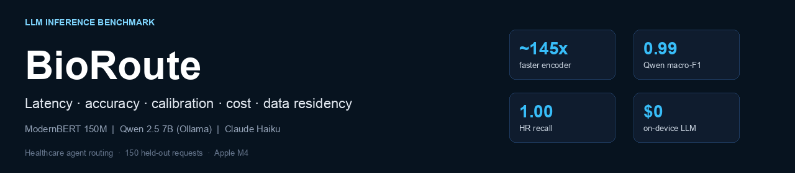
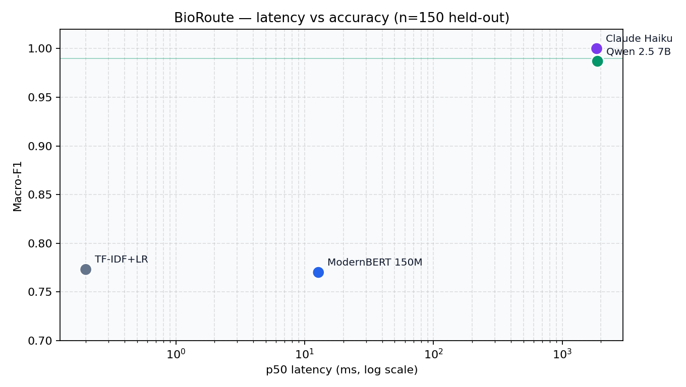

<p align="center">
  
</p>

**BioRoute** — LLM inference benchmark for healthcare agent routing: latency, accuracy, calibration, cost, and data residency.

[Methodology](docs/METHODOLOGY.md) · [Architecture](docs/ARCHITECTURE.md) · [Results JSON](reports/latest.json) · [Evidence agent](https://github.com/Akhilesh-Vangala/healthcare-evidence-agent)

<p align="center">PyTorch · Hugging Face · Ollama · scikit-learn</p>

# BioRoute

Which model should sit in front of a healthcare agent? Every request must be routed to the right workflow (`drug_label`, `clinical_trials`, `coverage`), escalate high-risk cases to a human (`human_review`), or be rejected (`out_of_scope`).

BioRoute measures that trade-off on a fixed 150-request held-out set across four routers:

| Router | Role in the comparison |
| --- | --- |
| TF-IDF + logistic regression | Classical, millisecond baseline |
| **ModernBERT-base (150M), fine-tuned** | Open-weight encoder on device |
| **Qwen 2.5 7B zero-shot (Ollama)** | Self-hosted open-weight LLM |
| Claude Haiku zero-shot (API) | Hosted cloud LLM reference |

Routes match the agent in [healthcare-evidence-agent](https://github.com/Akhilesh-Vangala/healthcare-evidence-agent).

## Headline results (n = 150, 30 per route)

Hardware: Apple M4, 16 GB (MPS). ModernBERT fine-tune: **178 s**.

| Router | Macro-F1 | `human_review` recall | ECE ↓ | p50 latency | Cost / 1k | Data leaves device? |
| --- | ---: | ---: | ---: | ---: | ---: | --- |
| TF-IDF + LR (temp-scaled) | 0.77 | 0.77 | 0.15 | **0.2 ms** | $0 | No |
| ModernBERT-base 150M (fine-tuned) | 0.77 | 0.83 | 0.082 | **13 ms** | $0 | No |
| **Qwen 2.5 7B (Ollama)** | **0.99** | **1.00** | **0.024** | 1.9 s | **$0** | **No** |
| Claude Haiku (API) | 1.00 | 1.00 | 0.058 | 1.9 s* | $0.053 | Yes |

\*Claude latency includes headless CLI overhead; raw API is lower.



**Resume-aligned takeaways**

- Fine-tuned **150M ModernBERT** is **~145× faster** than Qwen 2.5 7B (**13 ms** vs **1.9 s**) but weaker on accuracy (**0.77** vs **0.99** macro-F1).
- **Qwen 2.5 7B on Ollama** runs at **$0 / call**, keeps PHI on-device, hits **1.00 recall** on high-risk `human_review`, and matches the cloud API within **~0.01 F1**.
- Encoder train time on M4 GPU: **178 s**.

## Decision framing

```text
                    accuracy / calibration
                              ▲
                    Claude ●  Qwen ●
                              │
                              │
              ModernBERT ●    │
                              │
                 TF-IDF ●     │
                              └──────────────► latency (log)
                         fast              slow
```

| Prefer | Choose | Why |
| --- | --- | --- |
| On-device PHI + near-API quality | Qwen 2.5 7B via Ollama | 0.99 F1, ECE 0.024, $0, Apache-2.0 |
| Sub-20 ms routing | ModernBERT (after distillation) | 13 ms, but fix `out_of_scope` / HR misses first |
| Absolute floor latency | TF-IDF + LR | 0.2 ms; calibrate (ECE 0.26 → 0.15) |

**Production recommendation:** route with self-hosted 7B now; use it to label live traffic and distill into the encoder for millisecond serving. Gate any switch on `human_review` recall — a missed compliance escalation is the costly error.

## Per-route recall

| Router | drug_label | clinical_trials | coverage | human_review | out_of_scope |
| --- | ---: | ---: | ---: | ---: | ---: |
| TF-IDF + LR | 0.77 | 0.93 | 0.73 | 0.77 | 0.67 |
| ModernBERT fine-tuned | 0.80 | 0.83 | 0.80 | 0.83 | 0.57 |
| Qwen 2.5 7B | 0.97 | 1.00 | 0.97 | 1.00 | 1.00 |
| Claude Haiku | 1.00 | 1.00 | 1.00 | 1.00 | 1.00 |

## What is measured

| Axis | Metric | Why it matters for agent routing |
| --- | --- | --- |
| Accuracy | Macro-F1, per-route recall | Balanced across 5 routes |
| Safety | `human_review` recall | High-risk / compliance escalation |
| Calibration | ECE, Brier (± temperature scaling) | Confidence for abstain / escalate |
| Latency | p50 single-request ms | User-facing agent hop |
| Cost | USD / 1k requests | Hosted vs self-hosted |
| Residency | On-device vs vendor API | PHI / policy constraints |
| License | Apache-2.0 vs commercial | Self-hosting rights |

## Quick start

```bash
git clone https://github.com/Akhilesh-Vangala/bioroute.git
cd bioroute
python3.11 -m venv .venv && source .venv/bin/activate
pip install -e ".[transformers]"
ollama pull qwen2.5:7b          # self-hosted LLM router
make bench                      # or: bioroute-bench --out reports/latest.json
```

Encoder-only (no Ollama / Claude):

```bash
bioroute-bench --skip-llms --out reports/encoders-only.json
```

Claude predictions are cached in `results/claude_haiku_test_preds.npz` (delete to remeasure). Set `CLAUDE_BIN` if `claude` is not on `PATH`.

## Repository layout

```text
bioroute/
├── src/bioroute/
│   ├── data.py          routes, schemas, dataset I/O
│   ├── encoders.py      ModernBERT fine-tune, temperature scaling, latency
│   ├── llm.py           Ollama (Qwen) + Claude zero-shot routers
│   ├── metrics.py       ECE, Brier, abstain coverage
│   ├── benchmark.py     full comparison harness
│   └── cli.py           bioroute-bench entrypoint
├── data/                train.jsonl (synthetic) · test.jsonl (held-out)
├── reports/latest.json  machine-readable results
├── results/             cached LLM predictions
├── docs/                methodology, architecture, assets
├── tests/               unit tests for metrics
└── scripts/             data generation + plotting
```

## Data

| Split | n | Source |
| --- | ---: | --- |
| Train / val | 603 / 107 | Qwen-generated personas (`scripts/generate_train.py`) — **not** Claude, so the hosted baseline is not tested on its own phrasing |
| Test | 150 (30×5) | Hand-written hard cases (mixed intents, PHI-looking strings, off-label phrasing) |

## Limitations

- One fine-tune seed; n = 150. Qwen 0.99 vs Claude 1.00 is within noise.
- LLM “confidence” is verbalized, not softmax over logits.
- Test set is author-written; a larger independently labeled production set is the main next step.
- BiomedBERT is supported in code but not in the published table.

## License

MIT — see [LICENSE](LICENSE).
